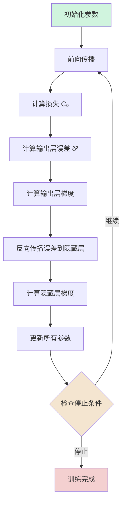

# Summary

本教程完整展示了一个两层神经网络的前向传播和反向传播过程，包括：

1. **前向传播**：逐层计算激活值
2. **损失计算**：使用均方误差
3. **[反向传播](反向传播.md)**：从输出层向输入层计算梯度  *每个 W 矩阵里的每个位置下次变化的 unit*
4. **参数更新**：使用梯度下降法
5. **验证效果**：损失值降低

# Cues

# Notes

## 网络结构

### 网络参数初始化

**输入层到隐藏层：**

- 权重矩阵：$W^{(1)} = \begin{bmatrix} 0.2 & -0.5 & 0.1 \ -0.3 & 0.4 & 0.2 \end{bmatrix}$
- 偏置向量：$b^{(1)} = \begin{bmatrix} 0.3 \ -0.1 \end{bmatrix}$

**隐藏层到输出层：**

- 权重矩阵：$W^{(2)} = \begin{bmatrix} 0.5 & 0.2 \end{bmatrix}$
- 偏置：$b^{(2)} = 0.1$

**输入数据：**

- $x = \begin{bmatrix} 2 \ 3 \ -1 \end{bmatrix}$
- 目标值：$y = 1$

## 一、前向传播

### 1. 输入层到隐藏层的计算

**公式：** $$z^{(1)} = W^{(1)}x + b^{(1)}$$

 $$a^{(1)} = \sigma(z^{(1)})$$

**矩阵计算：** $$z^{(1)} = \begin{bmatrix} 0.2 & -0.5 & 0.1 \ -0.3 & 0.4 & 0.2 \end{bmatrix} \begin{bmatrix} 2 \ 3 \ -1 \end{bmatrix} + \begin{bmatrix} 0.3 \ -0.1 \end{bmatrix}$$

**详细展开：** $$\begin{align} z_1^{(1)} &= 0.2 \times 2 + (-0.5) \times 3 + 0.1 \times (-1) + 0.3 \ &= 0.4 - 1.5 - 0.1 + 0.3 = -0.9 \end{align}$$

$$\begin{align} z_2^{(1)} &= (-0.3) \times 2 + 0.4 \times 3 + 0.2 \times (-1) + (-0.1) \ &= -0.6 + 1.2 - 0.2 - 0.1 = 0.3 \end{align}$$

**结果：** $$z^{(1)} = \begin{bmatrix} -0.9 \ 0.3 \end{bmatrix}$$

**激活函数：** $$a^{(1)} = \sigma(z^{(1)}) = \begin{bmatrix} \sigma(-0.9) \ \sigma(0.3) \end{bmatrix} = \begin{bmatrix} \frac{1}{1 + e^{0.9}} \ \frac{1}{1 + e^{-0.3}} \end{bmatrix} = \begin{bmatrix} 0.289 \ 0.574 \end{bmatrix}$$

### 2. 隐藏层到输出层的计算

**公式：** $$z^{(2)} = W^{(2)}a^{(1)} + b^{(2)}$$

 $$a^{(2)} = \sigma(z^{(2)})$$

**矩阵计算：** $$z^{(2)} = \begin{bmatrix} 0.5 & 0.2 \end{bmatrix} \begin{bmatrix} 0.289 \ 0.574 \end{bmatrix} + 0.1$$

**详细展开：** $$\begin{align} z^{(2)} &= 0.5 \times 0.289 + 0.2 \times 0.574 + 0.1 \ &= 0.1445 + 0.1148 + 0.1 = 0.3593 \end{align}$$

**激活函数：** $$a^{(2)} = \sigma(0.3593) = \frac{1}{1 + e^{-0.3593}} = 0.589$$

## 二、[[损失函数]]计算

**均方误差(MSE)：** $$C_0 = (a^{(2)} - y)^2 = (0.589 - 1)^2 = (-0.411)^2 = 0.169$$

## 三、反向传播

### 1. 计算输出层的误差信号

**定义误差信号：** $$\delta^{(2)} = \frac{\partial C_0}{\partial z^{(2)}}$$

**链式法则展开：** $$\delta^{(2)} = \frac{\partial C_0}{\partial a^{(2)}} \cdot \frac{\partial a^{(2)}}{\partial z^{(2)}}$$

**各项计算：**

- $\frac{\partial C_0}{\partial a^{(2)}} = 2(a^{(2)} - y) = 2(0.589 - 1) = -0.822$
- $\frac{\partial a^{(2)}}{\partial z^{(2)}} = \sigma'(z^{(2)}) = a^{(2)}(1 - a^{(2)}) = 0.589 \times 0.411 = 0.242$

**结果：** $$\delta^{(2)} = -0.822 \times 0.242 = -0.199$$

### 2. 计算输出层参数的梯度

**权重梯度公式：** $$\frac{\partial C_0}{\partial W^{(2)}} = \delta^{(2)} \cdot (a^{(1)})^T$$

**矩阵计算：** $$\frac{\partial C_0}{\partial W^{(2)}} = -0.199 \times \begin{bmatrix} 0.289 & 0.574 \end{bmatrix} = \begin{bmatrix} -0.0575 & -0.1142 \end{bmatrix}$$

**偏置梯度公式：** $$\frac{\partial C_0}{\partial b^{(2)}} = \delta^{(2)} = -0.199$$

### 3. 计算隐藏层的误差信号

**公式：** $$\delta^{(1)} = (W^{(2)})^T \delta^{(2)} \odot \sigma'(z^{(1)})$$

**步骤分解：**

**第一步：计算反向传播的误差** $$(W^{(2)})^T \delta^{(2)} = \begin{bmatrix} 0.5 \ 0.2 \end{bmatrix} \times (-0.199) = \begin{bmatrix} -0.0995 \ -0.0398 \end{bmatrix}$$

**第二步：计算激活函数导数** $$\sigma'(z^{(1)}) = a^{(1)} \odot (1 - a^{(1)}) = \begin{bmatrix} 0.289 \ 0.574 \end{bmatrix} \odot \begin{bmatrix} 0.711 \ 0.426 \end{bmatrix} = \begin{bmatrix} 0.2055 \ 0.2445 \end{bmatrix}$$

**第三步：Hadamard积** $$\delta^{(1)} = \begin{bmatrix} -0.0995 \ -0.0398 \end{bmatrix} \odot \begin{bmatrix} 0.2055 \ 0.2445 \end{bmatrix} = \begin{bmatrix} -0.0204 \ -0.0097 \end{bmatrix}$$

### 4. 计算隐藏层参数的梯度

**权重梯度公式：** $$\frac{\partial C_0}{\partial W^{(1)}} = \delta^{(1)} \cdot x^T$$

**矩阵计算：** $$\frac{\partial C_0}{\partial W^{(1)}} = \begin{bmatrix} -0.0204 \ -0.0097 \end{bmatrix} \times \begin{bmatrix} 2 & 3 & -1 \end{bmatrix} = \begin{bmatrix} -0.0408 & -0.0612 & 0.0204 \ -0.0194 & -0.0291 & 0.0097 \end{bmatrix}$$

**偏置梯度公式：** $$\frac{\partial C_0}{\partial b^{(1)}} = \delta^{(1)} = \begin{bmatrix} -0.0204 \ -0.0097 \end{bmatrix}$$

## 四、参数更新

**学习率：** $\eta = 0.1$

**更新公式：** $$\theta_{new} = \theta_{old} - \eta \cdot \frac{\partial C_0}{\partial \theta}$$

### 输出层参数更新

**权重更新：** $$W^{(2)}_{new} = \begin{bmatrix} 0.5 & 0.2 \end{bmatrix} - 0.1 \times \begin{bmatrix} -0.0575 & -0.1142 \end{bmatrix} = \begin{bmatrix} 0.5058 & 0.2114 \end{bmatrix}$$

**偏置更新：** $$b^{(2)}_{new} = 0.1 - 0.1 \times (-0.199) = 0.1199$$

### 隐藏层参数更新

**权重更新：** $$W^{(1)}_{new} = \begin{bmatrix} 0.2 & -0.5 & 0.1 \ -0.3 & 0.4 & 0.2 \end{bmatrix} - 0.1 \times \begin{bmatrix} -0.0408 & -0.0612 & 0.0204 \ -0.0194 & -0.0291 & 0.0097 \end{bmatrix}$$

$$W^{(1)}_{new} = \begin{bmatrix} 0.2041 & -0.4939 & 0.0980 \ -0.2981 & 0.4029 & 0.1990 \end{bmatrix}$$

**偏置更新：** $$b^{(1)}_{new} = \begin{bmatrix} 0.3 \ -0.1 \end{bmatrix} - 0.1 \times \begin{bmatrix} -0.0204 \ -0.0097 \end{bmatrix} = \begin{bmatrix} 0.3020 \ -0.0990 \end{bmatrix}$$

## 五、验证：使用更新后的参数进行前向传播

### 隐藏层计算（使用更新后的参数）

$$z^{(1)}_{new} = W^{(1)}_{new} \cdot x + b^{(1)}_{new}$$

$$a^{(1)}_{new} = \sigma(z^{(1)}_{new})$$

### 输出层计算（使用更新后的参数）

$$z^{(2)}_{new} = W^{(2)}_{new} \cdot a^{(1)}_{new} + b^{(2)}_{new}$$

$$a^{(2)}_{new} = \sigma(z^{(2)}_{new}) \approx 0.595$$

### 新的损失值

$$C_{new} = (0.595 - 1)^2 = 0.164$$

**改进效果：**

- 原损失值：$C_{old} = 0.169$
- 新损失值：$C_{new} = 0.164$
- 损失减少：$\Delta C = 0.005$

## 六、训练流程图

