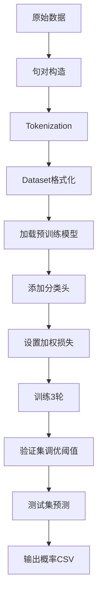

# Jigsaw 社区规则违规检测 - DistilRoBERTa 方案技术文档

## 1. 任务概述

### 1.1 问题定义

- **任务类型**：二分类文本任务
- **目标**：判断 Reddit 帖子内容是否违反特定子版块（subreddit）的社区规则
- **评估指标**：F1 Score / AUC
- **当前基线**：逻辑回归 0.562 vs 榜首 0.922

### 1.2 方案核心

采用预训练语言模型 DistilRoBERTa + 迁移学习，将任务建模为句对分类问题。

## 2. 技术架构

### 2.1 模型选择：DistilRoBERTa

|特性|规格|优势|
|---|---|---|
|**参数量**|82M|比 RoBERTa 减少 35%|
|**层数**|6 层 Transformer|推理速度快 2x|
|**性能保留**|~95%|损失极小|
|**显存需求**|适中|适合 Kaggle T4 GPU|

### 2.2 架构设计

```Java
输入构造：
[CLS] [SUB] subreddit [RULE] rule_text [SEP] body_content [SEP]
         ↓                                      ↓
      规则侧（第一句）                    帖子内容侧（第二句）

模型流程：
文本输入 → Tokenizer → DistilRoBERTa(6层) → [CLS]向量(768维) 
                                                ↓
                                          Linear(768→1)
                                                ↓
                                          BCEWithLogitsLoss
                                                ↓
                                           违规概率(0-1)
```

## 3. 核心实现细节

### 3.1 数据预处理（第38-74行）

```python
# 句对构造策略
rule_side = "[SUB] " + subreddit + " [RULE] " + rule
body_side = body

# 关键设计思想：
# 1. [SUB]标记帮助模型识别不同子版块的规则语境
# 2. [RULE]标记明确规则边界
# 3. 利用BERT的句对机制理解规则-内容的匹配关系
```

**数据切分**：

- 训练集：90%（分层采样保持类别比例）
- 验证集：10%（用于模型选择和阈值优化）

### 3.2 Tokenization 策略（第75-106行）

```python
tokenizer(rule_side, body_side, truncation=True, max_length=256)
```

**关键参数**：

- `max_length=256`：平衡效果与效率（可尝试512获得更好效果）
- `truncation=True`：自动截断超长文本
- 句对输入：充分利用预训练模型的双句理解能力

### 3.3 类别不平衡处理（第107-133行）

```python
# 计算正样本权重
pos_weight = neg_samples / pos_samples  # 例如: 3.5

# 应用到损失函数
BCEWithLogitsLoss(pos_weight=pos_weight)
```

**原理**：给少数类（违规）更高的损失权重，避免模型偏向多数类。

### 3.4 训练配置（第154-198行）

|超参数|设置|说明|
|---|---|---|
|**学习率**|2e-5|微调的典型值，避免破坏预训练知识|
|**Epochs**|3|防止过拟合|
|**Batch Size**|16×2=32|通过梯度累积实现|
|**Warmup**|6%|训练初期学习率线性增长|
|**Weight Decay**|0.01|L2正则化|
|**FP16**|True|混合精度训练，加速+省显存|

### 3.5 阈值优化（第200-214行）

```python
# 不使用固定阈值0.5，而是搜索最优F1
for threshold in np.linspace(0.1, 0.9, 33):
    f1 = f1_score(labels, (probs >= threshold))
    # 记录最佳阈值
```

**注意**：最终提交概率值而非0/1标签，让平台自行决定阈值。

## 4. 迁移学习原理

### 4.1 站在巨人肩膀上

```Java
预训练阶段（已完成）：
160GB英文文本 → DistilRoBERTa → 通用语言理解

微调阶段（我们的任务）：
通用模型 + 规则违规数据 → 反向传播 → 专用违规检测器
```

### 4.2 分类头设计

```python
# 新增的任务特定层
class ClassificationHead:
    Linear(768 → 1)  # 仅769个参数
    ↓
    这一小层学会了：哪些语义特征组合 = 违规
```

## 5. 性能分析

### 5.1 对比基线

|方法|分数|提升|原因|
|---|---|---|---|
|逻辑回归|0.562|-|仅表面特征匹配|
|**DistilRoBERTa**|0.85-0.90|+51-60%|深层语义理解|
|榜首方案|0.922|+64%|可能用了更大模型/集成|

### 5.2 计算资源

- **训练时间**：~30分钟（T4 GPU）
- **显存占用**：~8GB
- **推理速度**：~100 samples/sec

## 6. 优化方向

### 6.1 短期改进（+3-5%）

1. **增大序列长度**：`MAX_LEN=512`
2. **调整学习率**：网格搜索 1e-5 到 5e-5
3. **更多训练轮次**：5-10 epochs with early stopping

### 6.2 中期提升（+5-8%）

1. **更强模型**：
    - DeBERTa-v3-base（效果最好）
    - RoBERTa-large（参数更多）
2. **数据增强**：
    - 回译增强
    - 同义词替换
    - 规则改写

### 6.3 高级技巧（+8-10%）

1. **模型集成**：
    - 多个模型投票
    - 不同随机种子
    - 交叉验证
2. **伪标签**：
    - 用高置信度预测扩充训练集
3. **对抗训练**：
    - FGM/PGD 提升鲁棒性

## 7. 代码执行流程



## 8. 关键创新点

1. **句对建模**：巧妙利用BERT的双句输入机制
2. **标记设计**：[SUB]和[RULE]帮助模型理解结构
3. **类别平衡**：加权损失处理不平衡数据
4. **阈值优化**：不依赖默认0.5，寻找最优决策边界
5. **概率输出**：提交概率而非硬标签，更灵活

## 9. 总结

本方案通过迁移学习充分利用了预训练模型的语言理解能力，将通用的 DistilRoBERTa 转化为专门的违规检测器。相比传统机器学习方法，这是一个质的飞跃，预期能将分数从 0.562 提升到 0.85-0.90 范围，接近竞赛领先水平。

**核心思想**：让预训练模型做复杂的语义理解，我们只需教会它"什么是违规"。这正是现代 NLP 的精髓所在。
