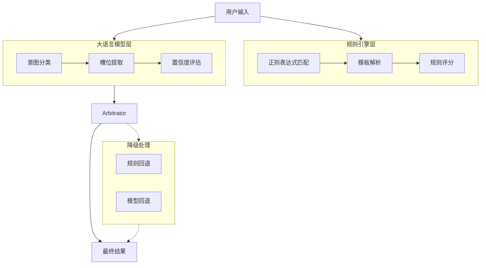
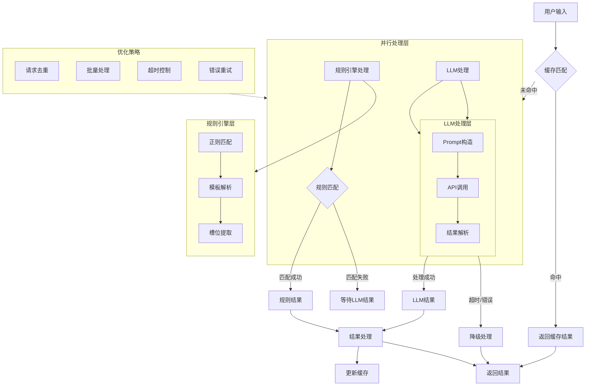

> [!Info]
>  问题的语义聚类    服务的语义聚类   之间找一个平衡  或者问题纯粹从语义出发
> 

1. 在准备的case足够多的情况下，PE可以让AI生成
意图识别的本质和代码一样，但是实践中往往被以文本+模糊认知的方式分散在很多人的脑子里。所以大量的测试集作为系统健壮性的兜底就显得尤为重要。
提示词缺乏注释机制，提示词的本质就是代码，要明确哪些稳定，哪些不稳定，为什么而改，哪些在测试，feature flag

2. 这100个query要对接服务方案A or 对接有xx skills的Agent B，那100个query要对接服务方案A or 对接有xx skills的Agent B
3. 从这些query中从业务视角出发聚合出定义和判断优先级，[[意图体系定义]]
4. 意图梳理清楚以后从语义视角出发，聚类做few shot


# Notes

## 训练方式

- **数据 < 500条**：用 SetFit（few-shot 学习）
- **数据 500-2000条**：标准 BERT 微调
- **数据 > 2000条**：BERT + 对比学习 + 难例挖掘

## 多意图怎么办

### 如果数据标注资源充足

→ 使用**主次意图分类**（方案2）

- 对客服响应策略更友好
- 可以按主意图路由到不同处理流程

### 如果数据标注资源有限

→ 使用**多标签分类**（方案1）

- 只需标注"这句话涉及哪些意图"
- 不需要区分主次关系

| 意图ID | 意图名称 (中文) | 意图名称 (英文)                      | 核心场景  | 描述                     |
|:--- |:-------- |:----------------------------- |:---- |:--------------------- |
| 1    | 查询航班      | Flight_Search                  | 机票预订  | 询问特定日期、地点之间的航班信息。|
| 2    | 预订航班      | Flight_Book                    | 机票预订  | 明确表示要预订已查询的航班。|
| 3    | 更改航班      | Flight_Change                  | 机票预订  | 询问或要求修改已有的航班订单。|
| 4    | 取消航班      | Flight_Cancel                  | 机票预订  | 询问或要求取消已有的航班订单。|
| 5    | 查询退改政策    | Flight_Policy_Inquiry          | 机票预订  | 询问航班的退票和改签规则。|
| 6    | 询问行李额     | Flight_Baggage_Inquiry         | 机票预订  | 询问特定航线或舱位的行李携带限制。|
| 7    | 办理值机      | Flight_Checkin_Request         | 机票预订  | 询问如何进行在线值机。|
| 8    | 查询酒店      | Hotel_Search                   | 酒店预订  | 询问特定城市、日期、人数的酒店信息。|
| 9    | 预订酒店      | Hotel_Book                     | 酒店预订  | 明确表示要预订已查询的酒店。|
| 10   | 更改酒店      | Hotel_Change                   | 酒店预订  | 询问或要求修改已有的酒店订单。|
| 11   | 取消酒店      | Hotel_Cancel                   | 酒店预订  | 询问或要求取消已有的酒店订单。|
| 12   | 询问设施      | Hotel_Amenity_Inquiry          | 酒店预订  | 询问酒店是否提供特定设施（如泳池、健身房）。|
| 13   | 询问入住/退房时间 | Hotel_Checkin_Time_Inquiry     | 酒店预订  | 询问酒店的入住和退房时间。|
| 14   | 查询景点      | Activity_Search                | 旅游/景点 | 询问特定地点或类型的旅游活动或景点。|
| 15   | 预订景点门票    | Activity_Book                  | 旅游/景点 | 明确表示要预订景点门票或活动。|
| 16   | 更改活动订单    | Activity_Change                | 旅游/景点 | 询问或要求修改已有的活动订单。|
| 17   | 取消活动订单    | Activity_Cancel                | 旅游/景点 | 询问或要求取消已有的活动订单。|
| 18   | 询问旅游攻略    | Activity_Guide_Inquiry         | 旅游/景点 | 询问目的地的旅游建议或行程规划。|
| 19   | 查询订单状态    | Order_Status_Inquiry           | 订单管理  | 询问特定订单的当前状态（如已确认、待支付）。|
| 20   | 询问支付方式    | Order_Payment_Inquiry          | 订单管理  | 询问支持的支付方式。|
| 21   | 申请发票/报销凭证 | Order_Invoice_Request          | 订单管理  | 要求开具发票或提供报销凭证。|
| 22   | 投诉/反馈     | Order_Complaint                | 订单管理  | 对服务或产品表示不满或提供反馈。|
| 23   | 询问客服联系方式  | Order_Contact_Support          | 订单管理  | 询问如何联系人工客服。|
| 24   | 感谢/赞扬     | General_Gratitude              | 通用/辅助 | 对机器人的帮助表示感谢。|
| 25   | 问候/开始对话   | General_Greeting               | 通用/辅助 | 开始对话，如“你好”、“在吗”。|
| 26   | 告别/结束对话   | General_Farewell               | 通用/辅助 | 结束对话，如“再见”、“谢谢”。|
| 27   | 肯定/确认     | General_Affirmation            | 通用/辅助 | 对机器人的提问表示“是”、“对”。|
| 28   | 否定/拒绝     | General_Negation               | 通用/辅助 | 对机器人的提问表示“否”、“不对”。|
| 29   | 询问机器人能力   | General_Capability_Inquiry     | 通用/辅助 | 询问机器人能做什么。|
| 30   | 寻求帮助      | General_Help                   | 通用/辅助 | 表达需要帮助，但未指明具体意图。|
| 31   | 询问价格      | General_Price_Inquiry          | 通用/辅助 | 询问任何产品或服务的价格。|
| 32   | 询问天气      | General_Weather_Inquiry        | 通用/辅助 | 询问特定城市的天气情况。|
| 33   | 询问时间/日期   | General_Time_Date_Inquiry      | 通用/辅助 | 询问当前时间或特定日期。|
| 34   | 询问促销/优惠   | General_Promotion_Inquiry      | 通用/辅助 | 询问是否有折扣或优惠活动。|
| 35   | 询问签证要求    | General_Visa_Inquiry           | 通用/辅助 | 询问特定国家或地区的签证要求。|
| 36   | 询问货币汇率    | General_Currency_Inquiry       | 通用/辅助 | 询问货币兑换汇率。|
| 37   | 询问交通方式    | General_Transportation_Inquiry | 通用/辅助 | 询问如何从A地到B地。|
| 38   | 询问会员权益    | General_Membership_Inquiry     | 通用/辅助 | 询问会员等级或权益。|
| 39   | 闲聊/非任务对话  | General_ChitChat               | 通用/辅助 | 任何与旅行任务无关的闲聊内容。|
| 40   | 意图不明确/噪音  | General_Out_of_Scope           | 通用/辅助 | 无法识别或意义不明的输入。|

这是“为 AI Chat 设计意图体系（Intent Taxonomy）”的经典问题变体。

# 1) 核心设计原则（一眼就能落地）

- **以动作为中心**：每个意图都要能触发一类明确的后端动作（API/工作流），否则宁可做实体或对话行为（dialog act），不要做意图。
    
- **互斥且可穷举（尽量 MECE）**：同一层级下尽量互斥；漏斗底端用 **OOS/拒识** 承接“不可归类”的表达。
    
- **粒度以“页面或接口”为度**：能对应到一个页面、一个服务或一个策略单元的粒度，既不过粗（全都归“咨询”），也不过细（把“晚到”“早到”拆成两个顶层意图）。
    
- **可观测、可评估**：意图必须能以**Macro-F1/per-class F1**、**延迟/吞吐**、**拒识指标**进行稳定评估。
    
- **演进有版本**：给意图体系加 **schema 版本号**，保持向后兼容（旧模型/历史数据可映射）。
    

# 2) 别把这些误当“意图”

- **实体/槽位（slots）**：城市、日期、人数、价位、星级、航段等属于实体，不是意图。
    
- **对话行为**：感谢、问候、澄清、追问、确认、拒绝等是 **dialog acts**，不等于“业务意图”。
    
- **情绪与语气**：情绪（愤怒/焦虑）应作为**特征**或“客服路由信号”，不要混入意图标签。
    
- **渠道元信息**：来自 App/H5/呼叫中心等，是样本切片标签，而非意图。
    

# 3) 三层结构与命名规范

- **域（domain）→ 意图（intent）→ 子意图（sub_intent）**
    
- 命名：`domain_intent[_sub]`；英文下划线小写；动作动词优先（search/book/cancel/modify/query…）
    
- 示例（OTA 酒店域）：
    
    - `hotel_search` → `sub_intent`: `nearby_poi`, `by_price`, `by_star`
        
    - `hotel_book` → `prepay_hold`, `with_breakfast`
        
    - `hotel_modify` → `extend_stay`, `change_guest`, `change_bed`
        
    - `hotel_cancel` → `free_cancel`, `waive_fee`
        

# 4) 多意图/复合意图策略

- **解析策略**（按业务强度从强到弱）：
    
    1. **多头预测**：允许一句话触发多个意图（如“查+订”），后端做**顺序编排**；
        
    2. **主-从拆解**：先判主意图（如 `hotel_search`），再以规则或小模型抽“伴随意图”（`price_alert`）。
        
- 规定**并发/串行**：如“先搜→再订”，串行落地；“比价+订阅提醒”，并行落地。
    

# 5) OOS/拒识与澄清

- 预留 **OOS** 超类，线上用 **双阈值**（`τ_low` 拒答兜底，`τ_high` 直接应答，中间走澄清）。
    
- 为“易混意图对”准备**澄清模板**：
    
    - 退款 vs 取消：
        
        - “你是想**取消未入住的订单**，还是**对已扣款发起退款**？”（附订单号候选）
            

# 6) 上下文与会话态

- **意图解析 ≠ 槽位齐全**：缺槽位走**slot-filling**补齐（时间、地点、人数/乘客等）。
    
- **会话状态机**：为关键链路（订、改、退、赔）设计状态机（`SELECT_ITEM → CONFIRM → PAY → ISSUE`），在每步允许**自然语言跳转**与**回退**。
    

# 7) 数据与标注规范（避免脏标签）

- **一条样本 = 一次可执行请求**；复合请求按策略拆分或标注“主/伴随”。
    
- **难例切片**：错别字、口语、ASR 噪声、中英混杂、数字与时间歧义、多语言。
    
- **一致性检查**：同一句子多标员一致率（κ 值）< 0.8 的类目重新定义边界或并类。
    

# 8) 评测与门槛（用于“能否上线”）

- 总体：Macro-F1（ID）≥ **0.92**；关键 Top-10 类 **F1≥0.95**、不得低于 0.92；
    
- OOS：AUROC ≥ **0.97**；FPR@95%TPR ≤ **5%**；
    
- 性能：P95 延迟（纯 NLU）**≤80ms**（CPU）/ **≤40ms**（GPU）；
    
- 看板：分版本对比、OOS 曲线、**混淆热力图（Top-30 类）**、多切片（渠道/语言/长度/ASR-WER）监控。
    

# 9) 多语言与语音入口

- 多语言优先 **共享 schema** + 语言特定实体辞典（地名/品牌/俗称），跨语蒸馏到 **XLM-R/mDeBERTa**。
    
- 语音场景：建 **ASR-WER 桶** 评测；文本侧对**数字、时间、货币**做鲁棒正则化（“两千五”“2k5”“$2,500”→标准数值）。
    

# 10) 与工具路由（Tooling）的边界

- 意图到 **动作映射表**（playbook）：
    
    - `hotel_search` → `SearchHotelAPI`（必需槽：`city|poi|date_range`）
        
    - `hotel_book` → `CreateOrderAPI`（必需槽：`hotel_id|room_id|checkin|nights|guests`）
        
    - `order_status` → `GetOrderStatusAPI`（必需槽：`order_id`）
        
- 缺槽位 → 走 **澄清问句模板**，并把澄清结果写回上下文。
    

---

## OTA 起步意图清单（可直接用）

**Hotel**：`hotel_search`, `hotel_book`, `hotel_cancel`, `hotel_modify`, `hotel_refund_query`, `policy_query`, `property_amenities`, `checkin_checkout`, `location_directions`  
**Flight/Train**：`flight_search`, `flight_change`, `flight_refund`, `train_search`  
**Order/Payment**：`order_status`, `invoice_request`, `coupon_query`, `payment_issue`, `price_alert`  
**Service**：`customer_service_contact`, `complaint`, `give_feedback`  
**General**：`chitchat`, `fallback_noise`, `oos`

---

## 样例 Schema（JSON）

```json
{
  "schema_version": "v1.3.0",
  "utterance": "上海本周五到周日两晚，近地铁，500以内",
  "domain": "hotel",
  "intent": "hotel_search",
  "sub_intent": "by_price_nearby",
  "entities": {
    "city": "上海",
    "checkin": "2025-10-31",
    "nights": 2,
    "budget_max": 500,
    "nearby": "地铁"
  },
  "dialog_act": "inform",
  "confidence": 0.91,
  "oos_score": 0.07,
  "context": {
    "channel": "app",
    "locale": "zh-CN",
    "session_id": "abc123"
  }
}
```

---

## 上线前 Checklist（压到可执行）

1. 意图-动作映射表完整，**必需槽位**定义清晰
    
2. 离线 Macro-F1 / per-class F1 / OOS 指标达标；Top-30 混淆对人工过样
    
3. 澄清模板覆盖易混意图对（改/退/退款、成人/儿童、发票类型）
    
4. 线上阈值与兜底策略（双阈值、转人工、重试流水线）
    
5. 分桶监控与告警（渠道/语言/ASR-WER/节假日）
    
6. 版本与回滚：`v_prev ↔ v_new` 映射、灰度策略、成本与延迟压测通过
    

需要的话，我可以把上述**意图清单+映射表+澄清模板**打成一份可导入你们标注平台/配置中心的 **CSV/JSON 套件**，再配一个 Notebook 生成分版本对比、OOS 曲线和混淆热力图，方便你们做首次上线评审。


上线标准

# 一、上线“硬门槛”（建议值，适用于 DeBERTa-v3-large / RoBERTa-large 微调的意图识别）

> 面向 OTA 业务，一般用 **Macro-F1** 作为总指标，并对关键意图做 **per-class F1** 把关，同时校验 OOS（拒识）能力与在线性能。

|维度|指标与口径|建议生产阈值（文本入口）|说明|
|---|---|--:|---|
|总体分类|Macro-F1（ID 类）|**≥ 0.92**|长尾多类时 0.90 是最低红线；0.94+ 进入“稳健”。|
|关键意图|per-class F1（如“下单/改期/退款/支付异常/人工”）|**≥ 0.95**（Top-10 关键类）；任一关键类**不得低于 0.92**|关键路径要更严。|
|长尾类|per-class F1@support<0.5%|**≥ 0.80** 或标注为“可回退/兜底”|结合置信度或少样本增强策略。|
|OOS 拒识|AUROC（ID vs OOS）|**≥ 0.97**|以验证集/领域 OOS 合成集联合评估。|
|OOS 拒识|FPR@95%TPR（ID 召回 95% 下的误接收率）|**≤ 5%**（理想 ≤ 3%）|业务高风险时更严。|
|置信拒答|Coverage@Precision≥0.98（只在高置信时作答的覆盖率）|**≥ 70%**|余量走“兜底/人工”。|
|延迟|P95 模型推理时延|**≤ 80 ms**（CPU/小 batch）；GPU ≤ 40 ms|仅 NLU，不含 ASR。|
|吞吐|线上每核 QPS|**≥ 30**（CPU，FP16/INT8 优化后可翻倍）|视部署而定。|
|稳定性|漂移监控（分桶 Macro-F1 与 OOS 指标波动）|**7 天内波动 ≤ 1.5pp**|数据分布、节假日流量切片监控。|

> 语音入口（ASR→NLU）可放宽 Macro-F1 约 1–2pp，或在看板上单列“ASR-WER≥X 切片”的指标门槛。

# 二、分版本对比（Release 看板该怎么长）

最小必备 4 块：

1. **主面板**：Macro-F1（ID）、AUROC（OOS）、FPR@95%TPR、Coverage@P≥0.98、P50/P95 延迟、成本/千次。
    
2. **分桶面板**：渠道（App/H5/Callcenter）、语言（zh/en/混合）、文本长度、时段（工作日/节假日）、ASR-WER 桶、错别字强度等。
    
3. **版本对比**：`v_prev` vs `v_new` 的差值条形图 + 可信区间；关键类 Top-N 的 **per-class F1 瀑布图**。
    
4. **错误热力图**：真实标签×预测标签（Top-30 混淆对），点击能展开样本与注意力/关键词解释。
    

**验收规则（示例）**

- `ΔMacro-F1 ≥ +0.5pp` 且 **关键类**无下降>0.5pp；
    
- `OOS FPR@95%TPR` 不劣化；
    
- 任一关键类 F1 < 0.92 必须给出改进计划或回退；
    
- 在线 P95 延迟不劣化且容量压测通过。
    

# 三、OOS 曲线与阈值如何落地

1. 训练时保留 ID 类交叉熵（可配 Focal），输出 **max-softmax** 或 **能量分数**。
    
2. 验证集上绘制：
    
    - **AUROC 曲线**（ID vs OOS）；
        
    - **FPR@TPR** 曲线，读出 95%/98% TPR 对应 FPR；
        
    - **Precision-Coverage** 曲线，用于“只在高置信作答”的运营策略。
        
3. 线上使用 **双阈值**：
    
    - 低于 `τ_low` → 直接兜底/转人工；
        
    - 高于 `τ_high` → 正常应答；
        
    - 中间区间走**澄清问句**或**轻量重试**（检索/重打分）。
        

# 四、错误热力图与质检采样

- 生成 **Confusion Matrix（Top-K 类）**：按样本数归一化，标红“语义近邻”的常错对（如 _退款_↔_取消_、_改期_↔_改签_、_酒店改期_↔_航班改签_）。
    
- 每个热区**等比抽样**做人工质检（建议每版 ≥ 200 条），输出语言现象标签：错别字、口语化、方言、代码混杂、价格/时间数值型误差、OOS 误接收等。
    
- 质检闭环形成**数据回灌清单**（难例与对抗样本），用于下版微调与数据增强。
    

# 五、模型训练与上线配置建议

- **损失**：CE 起步；类不均衡可加 **Focal γ=1–2** 或类权重；
    
- **优化**：AdamW + 余弦退火（3–5 epoch 热身、总 5–8 epoch），AMP 混合精度；
    
- **正则/增强**：R-Drop、Mixout；文本侧做 **拼写扰动、同义改写、ASR 噪声模拟**；
    
- **阈值选择**：以验证集 `FPR@95%TPR` 最优点设 `τ_high`；结合运营成本做 `τ_low`；
    
- **上线流程**：离线过门槛 → 影子流（1–5%）→ 金丝雀（10–20%）→ 全量；每阶段都跑上面的看板卡点。
    

---

如果你愿意，我可以把这些门槛和图表模板打包成一个**可直接填数据的评测看板（CSV+Notebook）**，包含：

- 版本对比表（per-class F1 差值）
    
- OOS ROC / FPR@TPR 曲线绘制脚本
    
- 混淆热力图与样本抽样脚本  
    你直接喂入你们当前 `v_prev` 和 `v_new` 的离线推理结果（含 `y_true / y_pred / score`）即可出图与生成评审页。


- 从项目视角拆解题目，开发独立 IM 系统，打造友好的 AI 交互方式。
- 整合项目群聊与文档信息，通过知识库问答、语义搜索、催办待办、项目进度总结等方式，全方位挖掘项目生命周期中的各种信息价值。
- 追踪社区最新实践，使用 OpenAI、Anthropic、Cerebras 等原生 API 的新特性
- Agent 智能交互解决日常工作中的繁琐操作
- 开发过程从 UI设计、前端、后端、PPT 制作，50% 以上由 AI 助力完成。

# 一、交互


1. 输入框输入@Agent 之后的信息触发后端意图识别接口
2. 提取出来的意图显示在图中卡片上，之后槽位信息可以加到卡片上，进一步优化
3. 用了前端 Debounce (防抖)，用户停止输入 800ms 后才调用 API，800ms 可以调整

# 二、整体架构（降级处理还待优化）



# 三、实现细节（缓存、错误重试还未实现）



# 四、场景分析

## 1. 语义搜索

## 2. 总结内容 or 形成结论

槽位里最关键的是起止时间

我可以帮你将这些消息按主题和事件进行分类。我会分析消息内容、时间连续性以及参与者之间的对话来进行分组。让我们把它分成几个主要的话题群:

1. 需求开发初期讨论与工时评估 (9月24-25日)
- 主要参与者:徐赟哲、崔宇、赵赵力等
- 主要内容:讨论工时评估、接口定义、技术方案等

1. 项目联调与问题修复 (10月8-11日)
- 主要参与者:赵赵力、乔路、董威宁、王颖yw等
- 内容:
    - 接口联调
    - bug修复
    - 配置调整
    - 环境问题处理

1. 项目发布与上线 (10月18日)
- 主要参与者:王颖yw、赵赵力、董威宁、刘丽慧等
- 内容:
    - 发布步骤确认
    - 配置检查与修改
    - 各模块依次发布
    - 发布验证

1. 线上问题跟进与优化 (10月21-29日)
- 主要参与者:刘丽慧、赵赵力、蔡创基等
- 内容:
    - 曝光率监控
    - 埋点问题
    - 用户反馈问题处理
    - 性能优化

这种分类可以帮助我们更好地理解整个项目的进展过程,以及在不同阶段遇到的主要问题。每个子群都有其相对独立但又相互关联的主题。你觉得这样的分类方式合理吗？如果需要,我可以针对某个子群做更详细的分析。

## 3. 进入发布模式

`QA 触发整个群进入发布模式`

```Java
"【FD-286154】 项目发布中
发布类型：prod
开始时间：2024-10-18 14:49:17
appcode：f_athena_order..."

"@徐赟哲  【即将发布周知】【FD-285952订单详情页二次售卖改版】 将于（2024-10-22）发布上线..."

"【发布delay】【FD-286155 订单详情页二次售卖改版】 未按计划发布时间（2024-10-11）发布..."
```

1. 测试验证相关:

```Java
"发布拦截了 快速点下哈"

"好的，刚才那个问题他们看下，应该不是本次改动的"

"我这边验证好了哈"
```

1. 配置管理相关:

```Java
"@王颖yw 审核一下配置，加了一下新的模块"

"这个标签是根据什么维度的"

"谨慎操作qconfig"
```

1. 问题排查相关:

```Java
"[obj type="image" value="https://qtalk.qunarzz.com/pp_qtalk_file_0003/f714c57c1cce3f27031df0935d477707.jpg" width=1236 height=628]@蔡创基 看下异常？"

"CompensateSecondSaleService_getCompensateInfo_param_error_Count]近期有值,但未添加报警..."

"qmall有npe我先回滚了"
```

## 4. 生成项目报告

1. 对于已完成的项目，提取项目过程流水，生成项目过程报告 `响应式生成` or `意图识别`
    1. 项目概览：项目名称、项目时长、参与团队、参与人、提出问题数、解决问题数、有效沟通次数
    2. 项目流水：人、时间、动作、结果
    3. 过程问题：问题描述、提出人、解决人、解决状态、解决时长
    4. 项目关键结论：项目群中的关键结论

## 5. 生成每周回顾

基于文档的 commit 的 diff 信息

## 6. 生成待办、催办

过去的群只有两个级别的信息 艾特我的 和不艾特我的 现在我们要借助ai做成三个  
分个人维度和多人维度甚至群维度

1. 主动 push 别人，`意图识别，强提醒的功能，如果做成响应式，可能会泛滥，所以需要人为触发并点击确认`
2. 主动查看自己，`响应式`or`意图识别` 每个人可以触发找出可能和自己相关的事情

```Java
- "@all 今天开发人员大家各自子啊群里面报一下自己的进度"
- "目前卡在支付前校验，待支付中心联调"
- "售前主流程/交易/辅营 售前阻塞在支付前校验，待支付中心联调,目前售前剩余授权回调验证 还得1pd调通"

"董威宁 邀请您参加腾讯会议
会议主题：董威宁的快速会议..."

"@乔路 能给我清个缓存不"

"@王颖yw 审批的时候也注意下哈"
```

1. 技术支持相关:

```Java
"@赵赵力 检查一下配置吧"

"@伊海迪 可以关注下这个问题"

"@国内交易热线 热线帮忙看下这个接口..."
```

1. 环境配置与问题排查

```Java
- "环境没搞通" "还没听人说 环境搞好了"
- "org.apache.dubbo.rpc.RpcException: No provider available..."
- "软路由 能不能进服务页，现在没法进 case没法覆盖到"
- "[obj type="url" value="http://portal.corp.qunar.com/servicePortal/apptask/console.html?id=9302554"] trade_core 重启下"
```

1. 联调与测试协调

```Java
- "@蔡宜身 现在进度如何呀，今天提测有风险吗？晚上能showcase吗？"
- "现在目前是各个环节都有卡点，先是北京-上海营销不出，现在是航班都没了"
- "@黄启孟 帮看下支付完成页的几个问题..."
```

1. 技术方案讨论

```Java
- "@赵述佳 这个cashierJumpUrl构建的时候 有判断payToken为空的时候不返这个url吗？"
- "@蔡宜身 轮询接口 报了参数异常"
- "batchSeq为什么是yyw格式的啊，不是20格式的啊，合单情况下又传的是什么呢"
```

1. 任务分配与协作

```Java
- "@李皓雪 皓雪姐看一下你那边的排期"
- "@all 任命陈民华担任项目技术负责人，请知晓！"
- "@黄启孟 @郝泽楠 @李皓雪 @谭鹏yy @何钢 @肖杨 @刁洪亮 来对一下排期吧"
```

1. 文档与知识共享

```Java
- "[obj type="url" value="https://wiki.corp.qunar.com/pages/viewpage.action?pageId=658756458"]"
- "按照这个更新checklist吧"
- "@赵述佳 技术方案的wiki在哪有"
```

# 五、一句话多个意图（待实现）

一句话有多个意图怎么办呢？将 suggestion 卡片做成跑马图，或者干脆不实现多意图？


# 六、避免幻觉

**Best-of-N verficiation**: Run Claude through the same prompt multiple times and compare the outputs. Inconsistencies across outputs could indicate hallucinations.  
并发调用多次，比较结果
